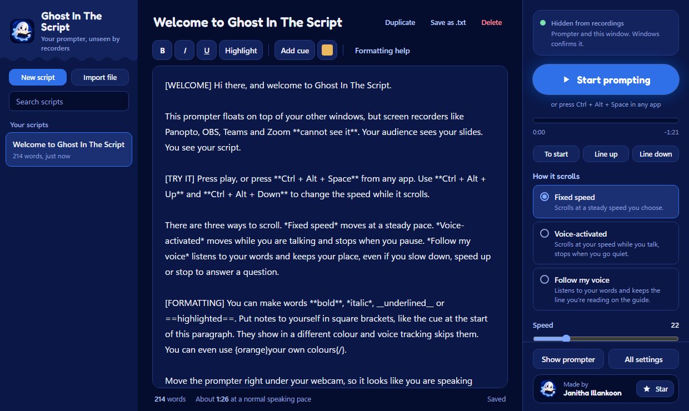
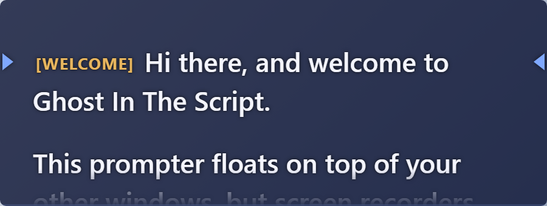

<p align="center">
  
</p>

<h1 align="center">Ghost In The Script</h1>

<p align="center">
  A teleprompter for Windows that sits on top of your slides but <b>doesn't show up in screen recordings</b>.<br/>
  Made by Janitha Illankoon.
</p>

<p align="center">
  <a href="https://github.com/JanithaIllankoon/ghost-in-the-script/releases/latest"><b>Download for Windows</b></a>
</p>

> **AI-assisted project.** Ghost In The Script was designed and written with the help of an AI coding assistant (Claude, by Anthropic), directed, reviewed and tested by Janitha Illankoon.

---

You record a lecture in Panopto (or OBS, Teams, Zoom). Your script floats right under your webcam so you can read it while looking at the camera. The recording only shows your slides.



## What it does

**Hidden from recordings.** The prompter uses a Windows feature (`WDA_EXCLUDEFROMCAPTURE`) that removes a window from every software capture: Panopto, OBS, Teams, Zoom, Snipping Tool and screen sharing all see whatever is behind it. You still see it on your monitor. The card at the top of the Present panel reads the setting back from Windows, so a green dot means it's really on. Tested with Panopto.

**Off the taskbar too.** A full-screen recording also captures your taskbar, so by default the app keeps no taskbar button there. Open it from the ghost in the tray, near the clock, or with **Ctrl+Alt+O**. Minimising the main window sends it to the tray. You can turn this off under **All settings > Window**.

**Three ways to scroll.**

| Mode | What happens |
|---|---|
| Fixed speed | Scrolls at a steady speed. Change it while it runs with the hotkeys or the slider. |
| Voice-activated | Scrolls while you talk and stops when you pause. |
| Follow my voice | Listens to your words and keeps the line you're reading on the guide. It waits while you ad-lib, catches up if you skip a line, and jumps if you start reading somewhere else. |

Speech recognition runs on your PC with [Vosk](https://alphacephei.com/vosk/). Nothing you say leaves your computer.

**Make the text readable your way.** Font, size, weight, line spacing, paragraph spacing, letter and word spacing, margins, alignment, all capitals, colours, background see-through level, a reading guide (arrows, line or band) at the height you choose, dimming of text you've already read, and mirroring for teleprompter glass.

**Control it from any app.** Global hotkeys work while Panopto has focus. The prompter can also let clicks pass through to the app underneath.

**Scripts.** A saved library with search, simple formatting, cue notes for yourself, and import from `.txt`, `.md`, `.docx` and `.rtf` (drag and drop works too).



## Install

1. Download `Ghost-In-The-Script_x.y.z_x64-setup.exe` from the [latest release](https://github.com/JanithaIllankoon/ghost-in-the-script/releases/latest).
2. Run it. It installs for your Windows user only, so it doesn't need admin rights.

Needs Windows 10 version 2004 or newer, or Windows 11. Windows SmartScreen may warn you because the installer isn't code-signed. Choose **More info**, then **Run anyway**.

If you used an earlier test build called "Ghost Prompter", uninstall it from **Settings > Apps**. Your scripts are kept.

## Using it

1. Write or paste your script, or import a file.
2. Pick how it should scroll.
3. Press **Start prompting**, or **Ctrl + Alt + Space** from any app.
4. Drag the prompter under your webcam with the toolbar that appears when you hover over it. Resize it from any edge.

### Hotkeys

| Action | Default keys |
|---|---|
| Play / pause | Ctrl+Alt+Space |
| Faster / slower | Ctrl+Alt+Up / Ctrl+Alt+Down |
| Back / forward one line | Ctrl+Alt+PageUp / Ctrl+Alt+PageDown |
| Back to the start | Ctrl+Alt+Home |
| Switch scroll mode | Ctrl+Alt+M |
| Click-through on / off | Ctrl+Alt+K |
| Show / hide the prompter | Ctrl+Alt+P |
| Show / hide the main window | Ctrl+Alt+O |

Change them under **All settings > Hotkeys**. If another app already uses one, the main window tells you and offers to change it.

**Every shortcut in one place:** press **Ctrl+/** in either window, select **Keyboard shortcuts and gestures** under the Start button, or press **?** on the prompter's toolbar.

When the prompter has focus: Space plays and pauses, Up and Down change the speed, PageUp and PageDown move a line, Home rewinds, and M switches mode. The mouse wheel scrolls by hand, and double-clicking a word jumps there.

**Click-through** lets clicks pass through the prompter to the app underneath. While it's on, a small badge on the prompter says so. Turn it off with **Ctrl+Alt+K**, the **Turn off** button in the main window, or **Turn off click-through** in the tray menu.

**Tray menu** (right-click the ghost near the clock): show the main window, show or hide the prompter, play or pause, turn off click-through, move the prompter to the top centre (handy if it ends up off-screen), and quit.

### Script formatting

```
**bold**   *italic*   __underline__   ==highlight==
[note to yourself]     shown in gold, skipped by voice tracking
{red}coloured words{/} any colour name or #hex
blank line             new paragraph
```

### Other languages

The built-in speech model is English. For another language, or better accuracy, download a model from the [Vosk model list](https://alphacephei.com/vosk/models), unzip it, and paste the folder path under **All settings > Voice > Speech model folder**.

## Limits

- It can't hide from a camera or phone pointed at your screen, or from a hardware capture card.
- The windows are also hidden from your own screenshots.
- The tray icon near the clock is part of the screen, so a full-screen recording can show it. Windows 11 usually tucks new tray icons into the hidden icons menu (the ^ arrow), and you can keep it there under **Settings > Personalization > Taskbar > Other system tray icons**.
- Windows only.

## Your data

Scripts and settings are saved on your PC in `%APPDATA%\app.ghostprompter.desktop\data.json`. The app doesn't connect to the internet. The only exception is the **Star on GitHub** button, which opens this page in your browser.

## Build it yourself

You need Node.js 20 or newer, Rust with the MSVC toolchain, and the Visual Studio C++ build tools.

```bash
npm install
npm run app:dev     # run the app with live reload
npm run app:build   # build the installer into src-tauri/target/release/bundle/nsis
```

The first run downloads the Vosk speech engine and English model (about 55 MB) from their official sources and checks their SHA-256 hashes. They are kept out of git because of their size. You can also fetch them yourself with `npm run setup:speech`.

To check the interface in a normal browser without the Rust side, run `npm run dev` and open `http://localhost:1420/dev/controls.html` or `/dev/prompter.html`. These dev-only pages fake the backend. Add `?skip=1` to skip the start screen, or `?fail=save`, `?fail=load`, `?capture=fail` or `?empty=1` to see the error and empty states.

| Folder | What's inside |
|---|---|
| `src/controls/` | Main window: start screen, scripts, editor, Present panel, settings |
| `src/prompter/` | The overlay window |
| `src/shared/` | Script formatting, voice matching (`align.ts`), settings |
| `src-tauri/src/` | Rust: capture hiding, global hotkeys, microphone and speech recognition |
| `scripts/` | Downloads the speech files |
| `dev/` | Browser preview pages for development |

Design choices and the reasoning behind them are in [DESIGN.md](DESIGN.md).

## Built with

- [Tauri 2](https://tauri.app) (MIT / Apache-2.0)
- [Vosk](https://github.com/alphacep/vosk-api) speech recognition and its small English model (Apache-2.0)
- [Fredoka](https://fonts.google.com/specimen/Fredoka) font via Fontsource (SIL Open Font License 1.1)
- [JSZip](https://stuk.github.io/jszip/) for reading Word files (MIT)

## License

[MIT](LICENSE) © 2026 Janitha Illankoon. You can use, change and share the code, including in your own projects, as long as you keep the copyright notice. The bundled third-party parts keep their own licenses, listed above.

## Support the project

If it saves you a retake, a star on GitHub helps other presenters find it.
